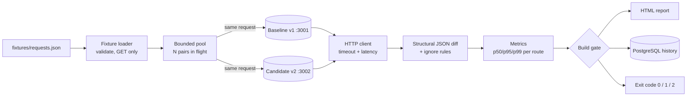

# ReplayLab

ReplayLab replays the same HTTP requests against two versions of an API (a baseline and a candidate), diffs the responses, checks per-route latency, and exits non-zero when the candidate regressed, so a CI job can block the deploy.

Example output against the deliberately broken candidate:

```
Missing field $.role                         (baseline "admin", candidate: absent)
type changed $.tags: [] -> null
status changed status: 404 -> 500
latency regression on /users: p95 24.9ms -> 126.6ms (+409%)
```

Stack: TypeScript on Node 24, Fastify for the demo APIs, Vitest, and PostgreSQL (optional, only for run history).

## How it works



| Module | What's in it |
|---|---|
| `src/replay/` | fixture loading, the fetch client (timeouts, error classification), replaying a pair |
| `src/engine/pool.ts` | bounded-concurrency pool, results kept in input order |
| `src/compare/` | recursive JSON diff with JSONPath locations, ignore rules (`$.users[*].field`), status/header checks, severities |
| `src/metrics/stats.ts` | nearest-rank percentiles, grouping paths into routes (`/users/101` -> `/users/:id`) |
| `src/run.ts` | repeat, warm-up, replay, compare, summarize, gate |
| `src/report/` | console summary and a self-contained HTML report |
| `src/db/` | Postgres schema, batched transactional insert (`unnest`), history queries |
| `src/apis/` | two demo Fastify APIs; the candidate has switchable regressions |

## Running it

```bash
npm install
npm run api:baseline          # terminal 1, http://127.0.0.1:3001
npm run api:candidate         # terminal 2, http://127.0.0.1:3002 (all regressions on)
npm run replay                # terminal 3, prints a summary and writes reports/latest.html
echo $?                       # 1 = regressions found
```

Pick the candidate's regressions with `REGRESSIONS=all | none | missing-field,type-change,status,order,added-field,latency`. With `REGRESSIONS=none` the run passes and exits 0.

| Command | |
|---|---|
| `npm run replay` | replay, compare, gate; writes `reports/latest.html` |
| `npm run replay -- --concurrency 20 --repeat 10 --timeout 1000` | override config values |
| `npm run replay -- --save` | also store the run in Postgres |
| `npm run replay -- history` / `show <id>` | list stored runs / show one run's failures |
| `npm run bench -- --levels 1,5,20,50 --repeat 20` | throughput and latency at several concurrency levels |
| `npm test` | unit + integration tests |

### Exit codes

| Code | Meaning |
|---|---|
| `0` | no regressions |
| `1` | functional or latency regression: block the deploy |
| `2` | ReplayLab itself failed (bad config, baseline unreachable, DB error with `--save`). Not a verdict on the candidate. |

### Postgres (optional)

```bash
docker compose up -d                    # Postgres 17 on localhost:5433
npm run replay -- --save                # creates the schema on first use
npm run replay -- history
```

`DATABASE_URL` overrides the connection string.

## Config (`replaylab.config.json`)

```json
{
  "concurrency": 10, "repeat": 5, "warmupRequests": 5, "timeoutMs": 2000,
  "ignorePaths": ["$.timestamp", "$.requestId", "$.version"],
  "compareHeaders": ["content-type"],
  "thresholds": {
    "maxFailedRequests": 0, "maxCandidateErrorRatePct": 0,
    "p95RegressionPct": 25, "p95ToleranceMs": 5, "minSamplesForLatency": 10,
    "addedFieldsAreBreaking": false
  }
}
```

A route counts as a latency regression when `candidate p95 > baseline p95 * (1 + p95RegressionPct/100) + p95ToleranceMs` and both sides have at least `minSamplesForLatency` samples. Without the fixed tolerance and the sample minimum, timer jitter on fast routes caused flaky failures.

## Numbers

Measured on a Windows 11 laptop, Node 24.19, everything on loopback.

Detection, 20 fixtures x 5 repeats against the fully regressed candidate:

| Injected regression | Reported as |
|---|---|
| admin `role` removed | `Missing field $.role` |
| empty `tags` -> `null` | `type changed $.tags: [] -> null` |
| not-found guard removed | `status changed: 404 -> 500` |
| N+1 query on the list endpoint | `latency regression on /users: p95 24.9ms -> 126.6ms (+409%)` |
| new `displayName` field | `Added field $.displayName` (warning, not breaking) |
| `timestamp` / `requestId` / `version` | ignored by rules; `REGRESSIONS=none` gives 100/100 pass, exit 0 |

Concurrency, 400 pairs per level (`npm run bench -- --levels 1,5,20,50 --repeat 20`):

| Concurrency | Wall time | Throughput | Baseline p50 / p95 | Candidate p95 |
|---:|---:|---:|---:|---:|
| 1 | 14,333 ms | 27.9 pairs/s | 26.2 / 31.4 ms | 68.4 ms |
| 5 | 2,366 ms | 169.0 pairs/s | 15.3 / 30.4 ms | 77.7 ms |
| 20 | 513 ms | 779.9 pairs/s | 9.6 / 20.3 ms | 55.0 ms |
| 50 | 370 ms | 1,080.0 pairs/s | 20.2 / 53.5 ms | 81.7 ms |

From 1 to 20 throughput goes up about 28x since the work is I/O-bound. From 20 to 50 it barely improves while p50/p95 roughly double, which is the servers starting to queue.

## Tests

- `tests/unit`: diff, ignore patterns, percentiles, pool (concurrency cap, ordering), verdicts.
- `tests/integration`: starts real Fastify servers on random ports and replays over HTTP. Checks each regression type is caught, a clean candidate passes, latency is pinned to the right route, and a hung request becomes a timeout.
- CI (`.github/workflows/ci.yml`): typecheck and tests, then the replay gate against a clean candidate (must exit 0) and against a broken one on :3003 (must exit 1, so the gate itself is tested).

## Limitations

- Fixtures are synthetic. Using real traffic would need a capture step that strips tokens and PII.
- GET only, since replaying writes repeats their side effects.
- Arrays are compared by index, so a reordered list shows up as lots of value changes. Matching by a key like `id` would fix that.
- Ignore rules are global, not per endpoint.
- On loopback the latency is mostly server time, not network. Windows timers have ~15.6 ms resolution, which quantizes small delays. Only compare runs from the same environment.
- A single Node process sends all requests, which caps how far concurrency can go.
